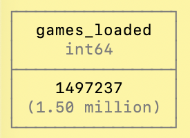
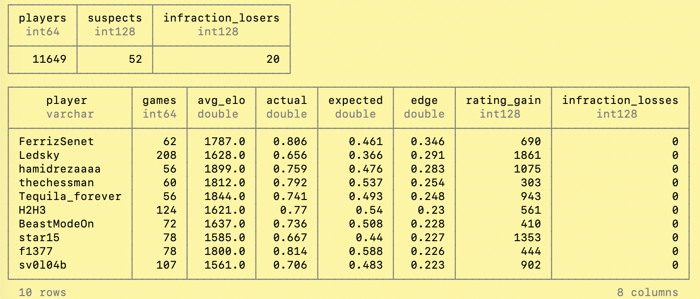
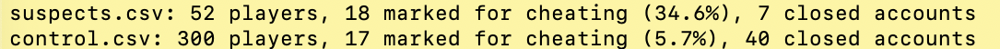

# Can SQL Catch Chess Cheaters?

Lichess publishes every rated game played on the site. A player's rating predicts how many points they should score against each opponent, so a player who keeps scoring far above that prediction is either improving fast or getting help. This project uses one month of games (January 2015, about 1.5 million games) to flag the players whose results beat their rating the most, then asks the Lichess API which of them were later marked for cheating.

It is a small sample of what the data allows, not a cheat detector. It looks at a couple of things that ratings and results can show, to see whether anything turns up, and it is not meant to be foolproof. Lichess publishes every month since 2013 as its own download, and the same SQL works on any of them by changing one filename in `build.sql`. January 2015 was picked because it is small. The newest months are around 30 GB and would run the same way, just slower.

## What the data looks like

The Lichess file is not a table. It is one huge text file, and every game in it looks like this: a block of header tags, a blank line, and one long line of moves.

```
[Event "Rated Bullet game"]
[Site "https://lichess.org/9fC5l6Xf"]
[White "Ukiteru9"]
[Black "Master_Chief"]
[Result "1-0"]
[UTCDate "2014.12.31"]
[UTCTime "23:00:37"]
[WhiteElo "1961"]
[BlackElo "1618"]
[WhiteRatingDiff "+4"]
[BlackRatingDiff "-4"]
[ECO "A04"]
[Opening "Zukertort Opening: Kingside Fianchetto"]
[TimeControl "0+1"]
[Termination "Time forfeit"]

1. Nf3 g6 2. d4 Bg7 3. Bg5 Nc6 4. h4 h6 5. Bd2 e6 6. e4 Nce7 7. e5 Nf6 ...
```

`build.sql` reads that text with DuckDB and turns each game into one row:

| game_id | white | black | white_elo | black_elo | white_change | black_change | result | termination |
| --- | --- | --- | --- | --- | --- | --- | --- | --- |
| 1 | Ukiteru9 | Master_Chief | 1961 | 1618 | 4 | -4 | 1-0 | Time forfeit |

and then into one row per player, which is what the analysis runs on:

| game_id | player | elo | opp_elo | rating_change | score |
| --- | --- | --- | --- | --- | --- |
| 1 | Ukiteru9 | 1961 | 1618 | 4 | 1.0 |
| 1 | Master_Chief | 1618 | 1961 | -4 | 0.0 |

## How it works

Three files, run in order:

1. `build.sql` reads the compressed game file as lines of text, keeps the header tags, splits them into one row per game, then one row per player per game with the points they scored (1, 0.5 or 0). Everything lands in `lichess.db`.
2. `analysis.sql` takes every player with 50 or more games and compares the points they scored with the points the Elo formula expected given their opponents' ratings. The gap is their `edge`. Anyone with an edge of 0.15 or more is a suspect, and a random 300 of the rest are the control group. It also counts games a player lost to a rules infraction, which is Lichess catching someone mid game.
3. `check_bans.py` sends both lists to the Lichess API and counts how many accounts carry a terms of service violation, which is how Lichess marks cheaters.

## Results

January 2015: 1,497,237 games, 11,649 players with 50 or more games, 52 suspects. 18 of the 52 suspects (34.6%) carry a terms of service mark, against about 7% of a random 300 player control group. One rule built from nothing but ratings and results finds cheaters at five times the base rate.







## Run it (Mac)

```
brew install duckdb
curl -L -O https://database.lichess.org/standard/lichess_db_standard_rated_2015-01.pgn.zst
duckdb lichess.db -f build.sql
duckdb lichess.db -f analysis.sql
python3 check_bans.py suspects.csv control.csv
```

The download is about 290 MB and is gitignored, along with the database and the CSV files. The data is CC0 from Lichess.

## What this can't do

A real detector would look at far more than this. The games file has no move times and engine evaluations on only a few games, so this only sees results, not moves. New accounts with provisional ratings gain rating fast and can look like suspects. And a terms of service mark can come years later for reasons other than cheating, so the ban check is a rough answer, not a verdict. The suspect list stays on your machine.


* build.sql was generated with AI to help me convert the data to tables so my SQL could run against it
* The code that i wrote by hand is the .py and analysis.sql
